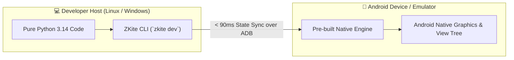

<div align="center">

# ZKite

### Build Native Android Apps in Pure Python with Instant Hot Reload

[](https://www.python.org/)
[-3DDC84?logo=android&logoColor=white)](https://developer.android.com/)
[](https://play.google.com/console)
[](https://zkite.cloud)
[](LICENSE)

<p align="center">
  <b>Zero Android NDK &bull; Zero Java/Gradle Setup &bull; Zero WebViews</b><br/>
  Real native Android views, sub-100ms ADB hot reload, and production Google Play bundles.
</p>

</div>
 
> Official developer documentation is live at **[zkite.cloud](https://zkite.cloud)**. PyPI release wheels and pre-built native runtime payloads will be published shortly.

---

## Code Preview

Write declarative mobile screens in pure Python with reactive state management:

```python
from zkite import store, Column, Text, Button, SystemBars

# 1. Reactive state store
@store
class CounterStore:
    count: int = 0

# 2. Declarative native UI
def view(state: CounterStore):
    return SystemBars(
        Column(
            "flex-1 justify-center items-center p-6 bg-slate-950 gap-4",
            Text("text-3xl font-extrabold text-white", "Hello, ZKite!"),
            Text("text-lg text-emerald-400 font-medium", f"Taps: {state.count}"),
            Button(
                "px-6 py-3 bg-emerald-500 rounded-xl font-bold text-white",
                Text("text-white text-base", "Tap Me"),
                on_tap=lambda: state.update(count=state.count + 1),
            ),
        ),
        status_color="#020617",
        navigation_color="#020617",
    )
```

Save the file—changes reflect on your connected phone in **< 90 milliseconds**.

---

## Production Benchmarks

No runtime bloat. Here are real, reproducible numbers for a standalone release build:

| Metric | Measured Value | What It Means |
| :--- | :--- | :--- |
| **Base APK Size** | **~16.4 MB** (`arm64-v8a`) | Standalone APK bundling stripped CPython 3.14, stdlib, & native engine. Google Play `.aab` delivers ~15 MB downloads. |
| **Cold Startup Time** | **~280 ms** | Cold launch to interactive first frame on modern devices (<40 ms warm resume). |
| **Hot Reload Latency** | **< 90 ms** | Live state-preserving source synchronization over ADB without restarting Python. |
| **Memory & Frame Rate** | **~42 MB RAM &bull; 60/120 FPS** | Zero WebViews. Draws directly into Android's hardware canvas at native display refresh rates. |

---

## How ZKite Compares



| Framework | UI Architecture | Local Toolchain Required | Development Feedback Loop |
| :--- | :--- | :--- | :--- |
| **Kivy** | Custom OpenGL canvas | Cython, Android NDK, Buildozer | Slow app restarts |
| **BeeWare** | Java wrapper (Rubicon) | 10+ GB Android Studio, JDK, Gradle | Full rebuild / deploy |
| **Flet** | Flutter wrapper (WebSockets) | Python + Flutter C++ Engine + Dart VM | IPC restart |
| **Chaquopy** | JNI bridge inside Java app | Android Studio, Gradle, Kotlin/Java | Gradle sync |
| **ZKite** | **Real Android Native Views** | **None (Just Python 3.14 + ADB)** | **Instant Hot Reload (< 90ms)** |

---

## Getting Started in 60 Seconds

### 1. Install ZKite
Install into an isolated Python 3.14 virtual environment:

```bash
# Linux / macOS
python3.14 -m venv .venv && source .venv/bin/activate
pip install zkite==1.1.2

# Windows (PowerShell)
py -3.14 -m venv .venv; .\.venv\Scripts\Activate.ps1
pip install zkite==1.1.2
```

### Using uv

`uv init` normally creates a starter `main.py`. ZKite owns that entry module, so
start with a bare uv project and then add ZKite:

```bash
uv init --bare
uv add zkite==1.1.2
uv run zkite new myapp .
uv run zkite dev
```

`uv init --bare` creates only `pyproject.toml`, so ZKite can create its `main.py`,
`.gitignore`, `app.json`, assets directory, and editor configuration without
overwriting files. Run these commands in the directory that will contain the app.

### 2. Scaffold a Project
```bash
zkite new my_mobile_app
cd my_mobile_app
```

### 3. Connect Device & Start Hot Reload
Enable USB Debugging on your phone (or start an emulator) and run:

```bash
zkite dev
```

> [!TIP]
> Edit and save any `.py` file—changes reflect on your device in under 100ms without restarting the app or resetting state.

---

## Essential CLI Commands

| Command | What It Does |
| :--- | :--- |
| `zkite dev` | Launches development preview with instant source hot reload |
| `zkite run` | Builds, installs, and launches a standalone APK directly on device |
| `zkite new <name>` | Scaffolds a new project with starter templates and settings |
| `zkite doctor` | Checks host Python 3.14, native payloads, and ADB connection |
| `zkite build apk` | Compiles a standalone `.apk` for local testing or direct download |
| `zkite build aab` | Generates a signed `.aab` (Android App Bundle) for Google Play |
| `zkite keygen` | Generates permanent cryptographic release signing keystores |

---

## Google Play Store Distribution

ZKite builds distribution-ready production bundles with two commands:

```bash
# 1. Generate cryptographic keystore without Java keytool or OpenSSL
zkite keygen --cn "My App Release Key"

# 2. Build multi-architecture Android App Bundle (.aab)
zkite build aab \
  --abi arm64-v8a \
  --abi x86_64 \
  --out dist/
```

The resulting `.aab` in `dist/` is ready for direct upload to the **Google Play Console**. End users install standard Android apps—they never need Python or pip.

---

## Compatibility Matrix

| Component | Target / Requirement |
| :--- | :--- |
| **Host OS** | Linux (x86_64), Windows 10/11 (x86_64), macOS |
| **Host Python** | CPython 3.14 |
| **Target Android** | Android 10+ (API Level 29+) |
| **Target Architectures** | `arm64-v8a` (Physical devices), `x86_64` (Emulators) |
| **Google Play Target** | Android API 36 |
| **Host Tooling** | Android Debug Bridge (`adb`) |

---

## Official Documentation

Comprehensive guides, API reference for all 19 widgets, troubleshooting matrices, and packaging guides:

👉 **[zkite.cloud — Official Documentation](https://zkite.cloud)**

---

## License

ZKite is open-source software licensed under the [MIT License](LICENSE).

See [responsive requests and swipeable tabs](docs/tasks-and-tabs.md) for the Task API, tabs, adaptive icons, and emoji support.
